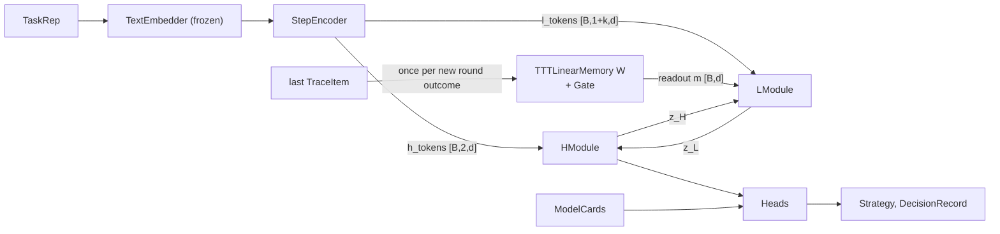

# Architecture

## Contents

1. System view
2. The three paths
3. Episode state across calls
4. Controller internals
5. Module table with shapes
6. Forward pass per decision
7. Selection rules per mode
8. Controller outputs

## 1. System view

```mermaid
flowchart TB
    FW["Agent framework or C3 simulator driver"]
    subgraph LAYER["Orchestration layer"]
        ENV["Environment<br/>C3 Simulator (Phases 0-2)<br/>C4 Executor (Phase 3)"]
        CTRL["C1 Controller"]
        SESS[("SessionStore<br/>dict / Redis")]
        CAT[("Catalogue<br/>ModelCards")]
        SCORE["C3 Scorer"]
        REC[("RecordStore<br/>Parquet / PostgreSQL")]
        LEARN["C2 Learning"]
        CKPT[("Checkpoints")]
    end
    PROV["Model providers (Phase 3)"]

    FW --> ENV
    ENV -->|"TaskRep"| CTRL
    CAT -->|"pool"| CTRL
    SESS <-->|"W, trace"| CTRL
    CTRL -->|"Strategy"| ENV
    ENV -->|"TraceItem"| CTRL
    ENV -.->|"Phase 3"| PROV
    ENV -->|"ExecutionTrace"| SCORE
    SCORE -->|"Score"| REC
    CTRL -->|"DecisionRecord"| REC
    REC --> LEARN
    LEARN --> CKPT
    CKPT --> CTRL
    SCORE -->|"profiles"| CAT
```



## 2. The three paths

| Path | Route | Frequency |
|---|---|---|
| Serving / rollout | Environment, Controller, Environment, Scorer | Every round |
| Learning | RecordStore (or rollout buffer), Learning, Checkpoints, Controller | Per training run |
| Onboarding | Catalogue register, Profiler, Catalogue, Controller reads pool | When the pool changes |

Onboarding never touches weights. The model head scores whatever cards are in the pool, so adding a model needs no retraining.

## 3. Episode state across calls

A workflow arrives as several separate calls. The controller keeps per-episode state in the `SessionStore`:

| Key | Content |
|---|---|
| `W` | TTT fast weights, d x d (float16 when stored) |
| `trace` | last k `TraceItem`s |
| `step_index`, `round` | position in the episode |

The controller object itself is stateless between calls, so it can be replicated.

## 4. Controller internals



The planner (H) reads the task; the fast module (L) reads the execution. This split is deliberate: it is the condition under which the specialisation question is tested.

## 5. Module table with shapes

Symbols: B batch, d = 128, e = 384, k = 2, P pool size, U tools offered, F = S + 2 capability size, S step types.

| Module | File | Built from | Input | Output | Approx. trainable params |
|---|---|---|---|---|---|
| `TextEmbedder` | `embed.py` | `SentenceTransformer("BAAI/bge-small-en-v1.5")`, frozen, cache by key | keys or strings | `[n, e]` | 0 (33M frozen) |
| `NumericFeaturizer` | `encoder.py` | log1p for costs, tokens, latency; fractions for budget; frozen mean/std from train split | raw numbers | normalised floats | 0 |
| `StepEncoder` | `encoder.py` | `Linear(e,d)`; `Embedding(S,d)` step type; `Embedding(P_max,d)` model ids; budget MLP `Linear(5,d) GELU Linear(d,d)`; trace MLP `Linear(e+6,d) GELU Linear(d,d)`; `Embedding(4,d)` token kind | task emb `[B,e]`, budget feats `[B,5]`, step type `[B]`, step emb `[B,e]`, trace emb `[B,k,e]`, trace feats `[B,k,6]`, trace model ids `[B,k]`, trace mask `[B,k]` | `h_tokens [B,2,d]`, `l_tokens [B,1+k,d]`, `obs [B,d]` for the newest trace item | ~140k |
| `RMSNorm` | `blocks.py` | γ-free (no learned scale), used pre-norm and at each module exit (MagicNorm) | `[*,d]` | `[*,d]` | 0 |
| `MLPBlock` | `blocks.py` | pre-norm residual SwiGLU: `x + down(SiLU(gate(RMSNorm(x))) * up(RMSNorm(x)))`, expansion 4 x 2/3 | `[B,d]` | `[B,d]` | ~132k |
| `HModule` | `core.py` | 2 x `MLPBlock`, exit `RMSNorm` | `[B,d]` | `z_H [B,d]` | ~265k |
| `LModule` | `core.py` | 2 x `MLPBlock`, exit `RMSNorm` | `[B,d]` | `z_L [B,d]` | ~265k |
| `TTTLinearMemory` | `memory.py` | bias-free `Linear(d,d)` key, value, query; learned `W0 [d,d]` (zero init); forgetting `Linear(d+1,1)`, bias -4 | obs `[B,d]`, `W [B,d,d]`, gate state | new `W [B,d,d]`, readout `m [B,d]`, surprise, rate, alpha | ~65k + W0 |
| `CfCGate` | `memory.py` | CfC cell (ncps default mode, re-implemented): 16 units, backbone 32 with LeCun-tanh, time input `dt`, state reset per episode and carried across writes; `rate = sigmoid(readout(c))` | `u [B,2d+1]`, state `c [B,16]`, dt `[B]` | rate `[B]` in (0,1), new `c` | ~11k |
| `StatelessGate` | `memory.py` | `sigmoid(MLP(u))`, hidden 32, Tanh; no state, no time | `u [B,2d+1]` | rate `[B]` | ~8k |
| `ConstantGate` | `memory.py` | one learned logit | any | rate `[B,1]` | 1 |
| `HRMCore` | `core.py` | runs the schedule; truncated backprop horizon; fixed `z_L` buffer (trunc normal, std 1) | tokens, `W`, gate | `z_H [B,d]`, diagnostics | sum of parts |
| `ModelScoringHead` | `heads.py` | `need = Linear(d,64)(z_H)`; `cap = Linear(F,64)(capability)`; success logit `= MLP([need*cap, need, cap])`; policy logit `= success logit - price_weight(z_H, lam) * log_price` | `z_H [B,d]`, caps `[P,F]`, log prices `[P]`, lam `[B]` | success logits `[B,P]`, policy logits `[B,P]` | ~25k |
| `HaltingHead` | `heads.py` | `Linear(d+2,d) GELU Linear(d,2)` on `[z_H, budget_frac, round]` | `[B,d+2]` | logits `[stop, continue]` `[B,2]` | ~17k |
| `ComplexityHead` | `heads.py` | `Linear(d,1)`, sigmoid | `z_H` | `[B]` in [0,1] | d+1 |
| `ToolHead` (Phase 2) | `heads.py` | same matching pattern over tool description embeddings | `z_H`, tool embs `[U,e]` | `[B,U]` | ~30k |
| `CategoricalHead` x 4 (Phase 2) | `heads.py` | `Linear(d,d) GELU Linear(d,3)` | `z_H` | logits for memory, depth, verification, topology | ~17k each |
| `Calibrator` | `calibrate.py` | one temperature, fitted on val, frozen | success logits | probabilities | 1 |
| `Controller` | `model.py` | wires everything | `TaskRep`, pool, session | `Strategy`, `DecisionRecord` | 737,046 measured (`full`); ~0.85M estimate (Phase 2) |

Per-module counts are estimates. Report only measured numbers. Measured trainable parameters (seed 0): `full` 737,046; `gate_off` 726,150; `gate_stateless` 734,438; `memory_off` / `context_free` 660,483; `full_attn` 1,065,494; `memory_off_attn` / `context_free_attn` 988,931.

Measured decision latency (batch 1, laptop CPU, 1 thread, cached task embedding): `full` 1.3 ms, `context_free` 1.0 ms, `full_attn` 3.2 ms, `context_free_attn` 2.9 ms. Embedding a new prompt with bge-small takes about 52 ms. Single seed, indicative.

### Masking for `context_free`

`context_free` masks earlier steps' trace items, the task token, the budget token and the memory readout, but keeps the current step's own round-1 item, so within-step escalation stays possible and the random-chain control stays fair (D10). Masked inputs are zeroed (MLP core) or hidden by the attention key mask (`context_free_attn`). Masking the readout is the same as having no memory, so the preset builds none. Nothing else changes. A test asserts the outputs are exactly invariant to the masked inputs.

### Gated-attention variant (D12)

`arch: attn` keeps six role tokens `[task, budget, step, trace-1, trace-2, memory]` as a sequence instead of averaging them, each plus a learned slot embedding (no RoPE: they are roles, not positions). Each H and L module is 2 pre-norm blocks of HRM-Text gated self-attention (fused bias-free gate/q/k/v projection, `o_proj(sigmoid(gate) * attn)`, 4 heads x 32) followed by SwiGLU, capped by a weightless RMSNorm (MagicNorm), in `controller/attention.py`. The H/L loop, fixed `z_L` init, input re-injection and staircase gradient horizon are the MLP core's, applied per token. An attention key mask hides absent trace slots and everything `context_free` must not see. H and L both receive the full masked token sequence (passed as both `h` and `x`), so they differ in schedule, not in which tokens they see. The heads read the step token. Residual diagnostics average over valid tokens only. Configs: `full_attn`, `memory_off_attn`, `context_free_attn`.

### Ablation switches

| Config | Switch | Effect |
|---|---|---|
| `full` | defaults | CfC gate, TTT memory, full context |
| `gate_off` | `gate: const` | rate is one learned constant |
| `gate_stateless` | `gate: stateless` | rate = sigmoid(MLP(u)) on the same input `u` as the CfC gate, no state, no time (tests whether the CfC form matters beyond surprise-gating, the Titans comparison; the "liquid" claim needs `full` > `gate_stateless`) |
| `memory_off` | `memory: none` | no `W`, `m = 0` |
| `context_free` | `context: query_only` | masking above |
| `full_attn` | `arch: attn` | gated-attention core, otherwise `full` |
| `memory_off_attn` | `arch: attn`, `memory: none` | attention core, no memory |
| `context_free_attn` | `arch: attn`, `context: query_only` | attention core, masking via the key mask |

The configs are Python presets in `controller/model.py` `CONFIGS`; the YAML files in `assets/conf/experiment/` are the Hydra mirror for teammates.

## 6. Forward pass per decision

```text
# 1. write (only if a round outcome has not been stored yet; D11)
o  = newest round's trace token                               # [B,d]
k  = norm(W_k o);  v = W_v o                                  # unit-norm key
s  = v - W k                                                  # surprise [B,d]
u  = [s/|s|, log|s|, o]                                       # gate input [B,2d+1]
r  = Gate(u, dt)                    in (0,1)                  # dt = 1/n_steps per write; CfC state carried across writes
a  = sigmoid(w_a . [log|s|, o] + b_a),  b_a = -4              # forgetting, starts near 0
W  = W0 + (1 - a)(W - W0) + r * s k^T                         # one delta-rule step (TTT-Linear) with Titans-style forgetting, no momentum
# 2. encode
h = RMSNorm(mean(H tokens)); x = pooled L tokens              # masked if context_free
q = norm(W_q h);  m = RMSNorm(W q);  x = x + m                # memory readout
# 3. reason (HRM-Text staircase: only the last bp module calls keep gradients)
z_H = h; z_L = z_L_init (fixed buffer, trunc normal std 1)
for c in range(2):
    for t in range(3):
        z_L = LModule(z_L + z_H + x)
    z_H = HModule(z_H + z_L + h)                              # h re-injected so the encoders get gradient
# 4. heads on z_H
# 5. select (Section 7), build Strategy and DecisionRecord
# 6. write W and trace back to the SessionStore
```

Notes:
- `W` starts each episode as the learned `W0` (zero-initialised). With unit-norm `k`, one write moves `W k` exactly a fraction `r` of the way to `v`, so no clipping is needed.
- Write timing: the post-round pass writes that round; a round-2 outcome is written at the next step's first pass; the episode's first pass writes nothing.
- Gradient horizon: `bp = 2 + floor(min(1, step / (0.2 total)) * 3)` module calls, split `H_bp = min(2, bp - 1)`, `L_bp = bp - H_bp`.
- `z_L` restarts each decision; `W` persists across decisions within the episode. That is the difference between reasoning state and memory.
- The residual diagnostic records `|z_L(t) - z_L(t-1)|` and `|z_H(c) - z_H(c-1)|` across the 6 inner steps (attn: averaged over valid tokens only). Expect a sawtooth in L.

## 7. Selection rules per mode

| Mode | Model | Halting |
|---|---|---|
| `greedy` (supervised eval) | cheapest model with calibrated success probability at least tau; else the most likely to succeed. Sweep tau for the frontier | escalate if p(continue) > 0.5, round 0, and budget allows the escalation model |
| `sample` (RL training) | sample from softmax(policy logits) | sample |
| `serve` (RL eval and live) | argmax policy logits with given lam; sweep lam for the frontier | argmax |

Escalation model: chosen by the same rule over models strictly more expensive than the round 0 model. At most 2 rounds per step.

## 8. Controller outputs

| Output | Type | Domain | Consumer |
|---|---|---|---|
| `model_id` | str | active `ModelCard.model_id` | Environment |
| `halt` | enum | stop, escalate | Environment |
| `tools`, `memory`, `depth`, `verification`, `topology` | Phase 2 | see contracts | Environment |
| `complexity` | float | [0,1] | logs, C2 bands |
| `confidence` | float | [0,1] calibrated | logs, guards |
| `log_probs`, `entropy` | dict | per head | C2 |
| `complexity_band` | int | 0..4 | C2 |
| `decision_state` | list[float] | length d | C2, analysis |
| `diagnostics` | dict | `surprise_norm`, `gate_rate`, `latency_ms` | plots |
