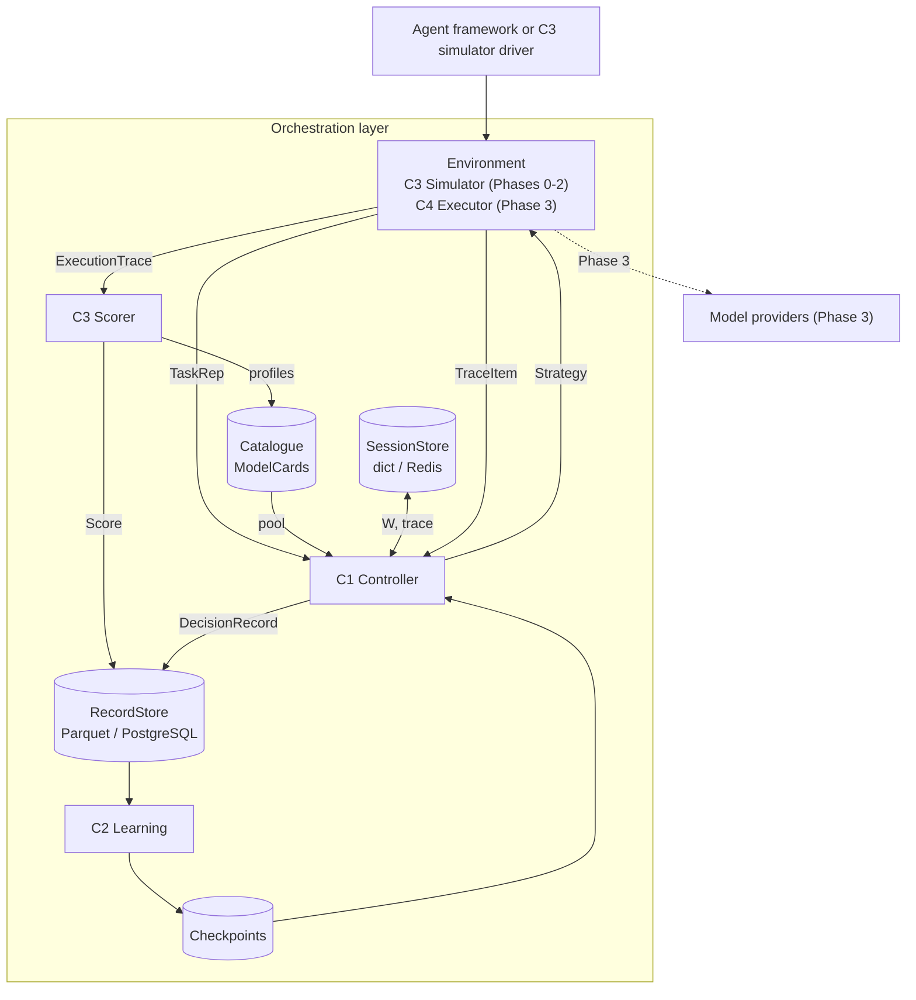
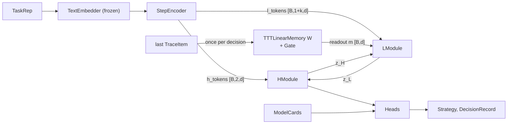

# Architecture

## Contents

1. System view
2. The three paths
3. Episode state across calls
4. Controller internals
5. Module table with shapes
6. Forward pass per decision
7. Selection rules per mode
8. Controller outputs

## 1. System view



## 2. The three paths

| Path | Route | Frequency |
|---|---|---|
| Serving / rollout | Environment, Controller, Environment, Scorer | Every round |
| Learning | RecordStore (or rollout buffer), Learning, Checkpoints, Controller | Per training run |
| Onboarding | Catalogue register, Profiler, Catalogue, Controller reads pool | When the pool changes |

Onboarding never touches weights. The model head scores whatever cards are in the pool, so adding a model needs no retraining.

## 3. Episode state across calls

A workflow arrives as several separate calls. The controller keeps per-episode state in the `SessionStore`:

| Key | Content |
|---|---|
| `W` | TTT fast weights, d x d (float16 when stored) |
| `trace` | last k `TraceItem`s |
| `step_index`, `round` | position in the episode |

The controller object itself is stateless between calls, so it can be replicated.

## 4. Controller internals



The planner (H) reads the task; the fast module (L) reads the execution. This split is deliberate: it is the condition under which the specialisation question is tested.

## 5. Module table with shapes

Symbols: B batch, d = 128, e = 384, k = 2, P pool size, U tools offered, F = S + 2 capability size, S step types.

| Module | File | Built from | Input | Output | Approx. trainable params |
|---|---|---|---|---|---|
| `TextEmbedder` | `embed.py` | `SentenceTransformer("BAAI/bge-small-en-v1.5")`, frozen, cache by key | keys or strings | `[n, e]` | 0 (33M frozen) |
| `NumericFeaturizer` | `encoder.py` | log1p for costs, tokens, latency; fractions for budget; frozen mean/std from train split | raw numbers | normalised floats | 0 |
| `StepEncoder` | `encoder.py` | `Linear(e,d)`; `Embedding(S,d)` step type; `Embedding(P_max,d)` model ids; budget MLP `Linear(5,d) GELU Linear(d,d)`; trace MLP `Linear(e+6,d) GELU Linear(d,d)`; `Embedding(4,d)` token kind | task emb `[B,e]`, budget feats `[B,5]`, step type `[B]`, step emb `[B,e]`, trace emb `[B,k,e]`, trace feats `[B,k,6]`, trace model ids `[B,k]`, trace mask `[B,k]` | `h_tokens [B,2,d]`, `l_tokens [B,1+k,d]`, `obs [B,d]` for the newest trace item | ~140k |
| `RMSNorm` | `blocks.py` | learned scale | `[*,d]` | `[*,d]` | d |
| `MLPBlock` | `blocks.py` | pre-norm residual: `x + Linear(4d,d)(GELU(Linear(d,4d)(RMSNorm(x))))` | `[B,d]` | `[B,d]` | ~132k |
| `HModule` | `core.py` | 2 x `MLPBlock`, exit `RMSNorm` | `[B,d]` | `z_H [B,d]` | ~265k |
| `LModule` | `core.py` | 2 x `MLPBlock`, exit `RMSNorm` | `[B,d]` | `z_L [B,d]` | ~265k |
| `TTTLinearMemory` | `memory.py` | `Linear(d,d)` key, value, query; learned `W0 [d,d]` | obs `[B,d]`, `W [B,d,d]`, rate `[B,1]` | new `W [B,d,d]`, readout `m [B,d]`, surprise `[B,d]` | ~65k |
| `CfCGate` | `memory.py` | backbone `Linear(d,d)` + Tanh; heads f, g, h `Linear(d,1)`; `t = sigmoid(-f*dt)`; `rate = sigmoid(t*g + (1-t)*h)` | surprise `[B,d]`, dt `[B,1]` | rate `[B,1]` in (0,1) | ~17k |
| `SigmoidGate` | `memory.py` | `Linear(d,1)`, sigmoid | surprise `[B,d]` | rate `[B,1]` | d+1 |
| `ConstantGate` | `memory.py` | one learned logit | any | rate `[B,1]` | 1 |
| `HRMCore` | `core.py` | runs the schedule; truncated backprop horizon | tokens, `W`, gate | `z_H [B,d]`, diagnostics | sum of parts |
| `ModelScoringHead` | `heads.py` | `need = Linear(d,64)(z_H)`; `cap = Linear(F,64)(capability)`; success logit `= MLP([need*cap, need, cap])`; policy logit `= success logit - price_weight(z_H, lam) * log_price` | `z_H [B,d]`, caps `[P,F]`, log prices `[P]`, lam `[B]` | success logits `[B,P]`, policy logits `[B,P]` | ~25k |
| `HaltingHead` | `heads.py` | `Linear(d+2,d) GELU Linear(d,2)` on `[z_H, budget_frac, round]` | `[B,d+2]` | logits `[stop, continue]` `[B,2]` | ~17k |
| `ComplexityHead` | `heads.py` | `Linear(d,1)`, sigmoid | `z_H` | `[B]` in [0,1] | d+1 |
| `ToolHead` (Phase 2) | `heads.py` | same matching pattern over tool description embeddings | `z_H`, tool embs `[U,e]` | `[B,U]` | ~30k |
| `CategoricalHead` x 4 (Phase 2) | `heads.py` | `Linear(d,d) GELU Linear(d,3)` | `z_H` | logits for memory, depth, verification, topology | ~17k each |
| `Calibrator` | `calibrate.py` | one temperature, fitted on val, frozen | success logits | probabilities | 1 |
| `Controller` | `model.py` | wires everything | `TaskRep`, pool, session | `Strategy`, `DecisionRecord` | ~0.75M (Phase 1), ~0.85M (Phase 2) |

All counts are estimates. Report only the number printed by `tests/controller/test_shapes.py`.

### Masking for `context_free`

`context = query_only` replaces trace tokens and the budget token with a learned null token and sets the memory readout `m` to zero. Nothing else changes. `tests/controller/test_masking.py` asserts the outputs are identical when trace, budget or `W` are changed.

### Ablation switches

| Config | Switch | Effect |
|---|---|---|
| `full` | defaults | CfC gate, TTT memory, full context |
| `gate_off` | `gate: constant` | rate is one learned constant |
| `gate_sigmoid` | `gate: sigmoid` | rate is a plain learned function of surprise (tests whether the CfC form matters beyond surprise-gating, the Titans comparison) |
| `memory_off` | `memory: none` | no `W`, `m = 0` |
| `context_free` | `context: query_only` | masking above |

## 6. Forward pass per decision

```text
# 1. observe (skip if no previous round in this episode)
obs      = StepEncoder.encode_item(last TraceItem)            # [B,d]
key, val = K(obs), V(obs)
surprise = val - W @ key                                       # [B,d]
rate     = Gate(surprise, dt)                                  # [B,1]
W        = W + rate * outer(surprise, key) / (|key|^2 + eps)   # TTT-Linear step on ||W key - val||^2
# 2. encode
h_tokens, l_tokens = StepEncoder(TaskRep)                      # masked if context_free
# 3. reason (truncated backprop: only the last n inner steps keep gradients)
z_H = mean(h_tokens); z_L = z_L_init (learned, [d])
x_L = mean(l_tokens); m = W @ Q(z_H)
for c in range(2):
    for t in range(3):
        z_L = LModule(z_L + z_H + x_L + m)
    z_H = HModule(z_H + z_L)
# 4. heads on z_H
# 5. select (Section 7), build Strategy and DecisionRecord
# 6. write W and trace back to the SessionStore
```

Notes:
- `W` starts each episode as the learned `W0`.
- `z_L` restarts each decision; `W` persists across decisions within the episode. That is the difference between reasoning state and memory.
- The residual diagnostic records `|z_L(t) - z_L(t-1)|` and `|z_H(c) - z_H(c-1)|` across the 6 inner steps. Expect a sawtooth in L.

## 7. Selection rules per mode

| Mode | Model | Halting |
|---|---|---|
| `greedy` (supervised eval) | cheapest model with calibrated success probability at least tau; else the most likely to succeed. Sweep tau for the frontier | escalate if p(continue) > 0.5, round 0, and budget allows the escalation model |
| `sample` (RL training) | sample from softmax(policy logits) | sample |
| `serve` (RL eval and live) | argmax policy logits with given lam; sweep lam for the frontier | argmax |

Escalation model: chosen by the same rule over models strictly more expensive than the round 0 model. At most 2 rounds per step.

## 8. Controller outputs

| Output | Type | Domain | Consumer |
|---|---|---|---|
| `model_id` | str | active `ModelCard.model_id` | Environment |
| `halt` | enum | stop, escalate | Environment |
| `tools`, `memory`, `depth`, `verification`, `topology` | Phase 2 | see contracts | Environment |
| `complexity` | float | [0,1] | logs, C2 bands |
| `confidence` | float | [0,1] calibrated | logs, guards |
| `log_probs`, `entropy` | dict | per head | C2 |
| `complexity_band` | int | 0..4 | C2 |
| `decision_state` | list[float] | length d | C2, analysis |
| `diagnostics` | dict | `surprise_norm`, `gate_rate`, `latency_ms` | plots |
