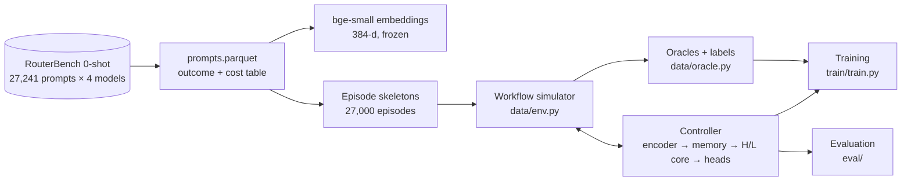
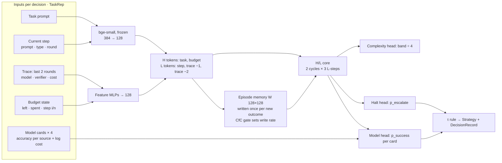

# neural-core: C1 Adaptive Orchestration Controller

Research prototype for **J26-DS-359, component C1** (V M Wickramaarachchi, IT23230460).

A multi-step LLM workflow makes many model calls. Each call can go to a cheap, weak model or an expensive, strong one. This project builds a small neural **controller** that makes that choice at every step. It uses not just the current question but the **state of the workflow**: what happened at earlier steps, whether they failed, and how much budget is left.

**Research question.** Does a controller that reads workflow state beat one that reads only the current query on the quality–cost trade-off? And what does a liquid-gated episode memory add?

The full design, with every decision and its rationale, is in [`docs/IMPLEMENTATION_PLAN_neural_core.md`](docs/IMPLEMENTATION_PLAN_neural_core.md). Section §1a D1–D11 is binding.

---

## 1. How it fits together



1. **Data.** RouterBench gives, for each prompt, whether each pool model answered it correctly and what the call cost.
2. **Simulated workflows.** Prompts are chained into episodes of 3–6 steps under a budget, with rules that make earlier steps matter.
3. **Controller.** At each step it reads the workflow state and outputs a `Strategy`: which model to call, and whether to escalate.
4. **Training.** Episodes are played live in the simulator, and the controller learns to predict which models will succeed.
5. **Evaluation.** Quality and cost are compared against baselines and an oracle that knows every outcome in advance.

---

## 2. Data

| Item | Value |
|---|---|
| Source | `withmartian/routerbench`, 0-shot split (downloaded into `data/raw/`) |
| Kept sources (0/1 scored) | MMLU (all subjects grouped), HellaSwag, ARC-Challenge, Winogrande, MBPP = 5 step types |
| Dropped | grade-school-math (scores in 0.25 steps), MT-Bench (graded), small miscellaneous evals |
| Prompts | 27,241 after removing 16 duplicate texts |
| Split | 80/20 train/test, then 10% of train held out for validation, per source. Fixed **before** any episode is built, so no prompt appears in two splits |
| Pool (cheapest → strongest) | mistral-7b-chat, mixtral-8x7b-chat, gpt-3.5-turbo-1106, gpt-4-1106-preview |
| Cost of a call | RouterBench's per-prompt `total_cost` (the paper gives no pricing date) |
| Difficulty band | Number of pool models that get the prompt wrong (0–4) |

Caveats (spec D11): the paper's main MMLU/HellaSwag/ARC/Winogrande results are 5-shot, so our 0-shot numbers are **not comparable to its tables**. MBPP correctness is judged by GPT-4 in RouterBench, so its labels are noisier.

### Episodes (`data/episodes.py`)

Each episode lists 3–6 prompts and a starting budget. About a third of episodes cannot afford gpt-4 on every step.

| Type | Share | Rule | Why context should help |
|---|---|---|---|
| Correlated difficulty | 40% | All prompts from one source and one difficulty band | Early steps reveal how hard the task is |
| Retry | 25% | If the verifier flags a step as failed, the same prompt comes back once | The model that failed is now known to fail |
| Error propagation | 20% | After a failure by tier *j*, only tiers > *j* can succeed next step | A past failure changes what the next step needs |
| Plain random chain | 15% | Unrelated prompts | **Control:** context should *not* help here |

Episodes store only prompts and budget. Outcomes are computed live, because they depend on which models were chosen earlier.

### Simulator (`data/env.py`)

- **Rounds:** a step is one round, or two if the controller **escalates** to a strictly more expensive model. The last round's answer counts.
- **Budget:** a round that costs more than the budget left is not run; that step scores 0 and the episode ends.
- **Verifier:** the controller never sees true correctness. It sees a **noisy verifier** signal, flipped 15% of the time (deterministic per episode, step, round and model, using a blake2b hash).
- **Immutable states:** the simulator is pure-functional, so the oracle can search it exactly.

### Oracles and labels (`data/oracle.py`)

| Oracle | How it chooses | Used for |
|---|---|---|
| Per-step oracle | Cheapest model that succeeds, otherwise the cheapest | Supervised label and the behaviour policy |
| Episode oracle | Exact search over every action sequence, maximising correct steps, then minimising spend | **Ceiling on every result**; checked against brute force in the tests |

---

## 3. Controller architecture



### 3.1 Inputs (`controller/features.py`, `controller/encoder.py`)

The features are built **only from what a deployed controller could see**: prompts, the noisy trace and the budget. Ground truth is read only to build training targets, and a test enforces this.

- **H tokens (task-level):** the task (embedding of the episode's first prompt) and the budget state.
- **L tokens (step-level):** the current step (prompt + type + round + phase), plus the last 2 trace items. Each trace item carries the model's card, the verifier signal, the cost, whether it was an escalation, and which step it came from.

### 3.2 Episode memory (`controller/memory.py`)

The memory is a fast-weight matrix `W`. It is reset to a learned `W₀` at the start of each episode and **updated at test time** after every round. It is re-implemented from TTT-Linear (Sun et al. 2024) and Titans (Behrouz et al. 2025):

```
k = norm(W_k o)      v = W_v o      q = norm(W_q h)
s = v − W k                                   surprise
r = gate([s/‖s‖, log‖s‖, o], Δt)               write rate ∈ (0,1)
α = σ(w·[log‖s‖, o] − 4)                       forgetting, starts near 0
W ← W₀ + (1 − α)(W − W₀) + r · s kᵀ
readout = RMSNorm(W q)   → added to the L input
```

With a unit-norm key, one write moves `W k` exactly a fraction `r` of the way to `v`, so the memory cannot blow up.

The **gate** chooses `r`:

| Gate | Config | What it is |
|---|---|---|
| CfC cell | `full` | Closed-form continuous-time cell (Hasani et al. 2022, ncps default mode). 16 units, its own state carried across the episode's writes, time input Δt = 1/n_steps |
| Stateless MLP | `gate_stateless` | Same input, no state, no time |
| Constant | `gate_off` | One learned rate |

### 3.3 H/L reasoning core (`controller/core.py`)

Adapted from HRM-Text (`hrm_nocarry_bp_warmup.py`, Apache-2.0; see `LICENSE-HRM-Text`).

```
h = RMSNorm(mean(H tokens));  x = mean(L tokens) + memory readout
z_H = h;  z_L = fixed random init
for cycle in 1..2:
    for step in 1..3:  z_L = L(z_L + z_H + x)
    z_H = H(z_H + z_L + h)
```

- Each module is 2 pre-norm **SwiGLU MLP** blocks capped by a weightless RMSNorm (HRM-Text's "MagicNorm").
- No attention: each module processes one vector, and TRM finds MLPs better on small fixed contexts.
- **Truncated backprop** follows HRM-Text's staircase: the horizon widens from 2 to 5 module calls over the first 20% of training.

### 3.4 Heads and policy (`controller/heads.py`, `train/rollout.py`)

- **Model head:** `logit_m = w·SiLU(A z_H + card_m) + b`. The pool is a **list of cards**, so a new model can be added without new output slots.
- **Halt head:** probability that escalating would help. It is read from a **second forward pass after round 1**, once that round's verifier result is visible.
- **Complexity head:** predicts the difficulty band.
- **τ rule:** among models affordable by card cost, pick the cheapest with `p_success ≥ τ`; if none clears τ, pick the most likely to succeed. Escalate if `p_escalate > 0.5` and a stronger affordable model exists. Sweeping τ traces the quality–cost curve.

### 3.5 Contracts (`controller/contracts.py`)

`TaskRep` (input), `Strategy` (output), `DecisionRecord` (log), `TraceItem` and `ModelCard`, all at version v1. `Strategy` also carries `tools`, `memory`, `depth`, `verification` and `topology`, fixed at defaults in this prototype. `controller/stub.py` returns a random but valid `Strategy` so other components can integrate before the model exists.

### 3.6 Configs (ablations, in `controller/model.py`)

| Config | Change from `full` | Question it answers |
|---|---|---|
| `full` | none | The proposed method |
| `gate_stateless` | CfC gate → stateless MLP | Does the *liquid* part (state + time) help? |
| `gate_off` | gate → one constant rate | Does choosing the write rate help? |
| `memory_off` | no memory | Does the episode memory help? |
| `context_free` | earlier trace, task, budget and memory masked | **Main comparison:** does reading the workflow help at all? |

Measured size: **737,046** trainable parameters for `full`.

---

## 4. Training (`train/`)

- **Rollout engine** (`train/rollout.py`): plays a batch of episodes in lockstep, one forward pass per decision, with each episode's memory row kept separate. Training and evaluation use the same loop.
- **Behaviour policy:** at each step the action comes from the per-step oracle (50%), a random model (25%), or the current controller (25%; the oracle stands in during epoch 1). Labels are computed for every model at every visited state.
- **Loss:** BCE on each model's success, plus BCE for escalation (on post-round passes only), plus MSE for complexity.
- **Optimiser:** AdamW (lr 3e-4, weight decay 0.01), cosine decay, batch 256 episodes, gradient clip 1.0, up to 20 epochs, early stopping on validation loss (patience 3).
- **EMA of weights with warm-up**, decay `min(0.999, (1+t)/(10+t))`. Validation and checkpoints use the EMA.

---

## 5. Results so far (validation, seed 0; indicative only)

The test set is held back for the final numbers.

| Policy | Quality | Cost / episode | Escalation | Correlated | Retry | Propagation | Random chain |
|---|---|---|---|---|---|---|---|
| Always mistral-7b | 0.228 | $0.0001 | | | | | |
| Random | 0.553 | $0.0023 | | | | | |
| Always gpt-4 | 0.689 | $0.0070 | | | | | |
| `memory_off` | 0.682 | $0.0028 | 9.9% | 0.745 | 0.673 | 0.550 | 0.701 |
| `gate_off` | 0.693 | $0.0030 | 11.1% | 0.764 | 0.682 | 0.567 | 0.692 |
| `gate_stateless` | 0.699 | $0.0031 | 11.2% | 0.768 | 0.693 | 0.563 | 0.705 |
| `full` | 0.699 | $0.0029 | 11.9% | 0.774 | 0.683 | 0.563 | 0.704 |
| Episode oracle (ceiling) | 0.924 | $0.0013 | | | | | |

- Every learned controller matches always-gpt-4 quality at about **40% of the cost**.
- Memory helps a little, mostly on correlated episodes, and barely on random chains, which is the expected pattern.
- The gate variants are indistinguishable with one seed.
- **Main gap to the oracle:** the controllers almost never trust mistral-7b (about 1% of steps against the oracle's 25%).
- **Latency on a laptop CPU, one thread:** 1.6 ms median per decision with a cached embedding. Embedding a new prompt with bge-small takes about 52 ms.

**Not yet shown:**
- `context_free` (the main comparison) is not trained yet.
- There are no seeds 1–2 yet.
- Calibration and the τ sweep are not done yet.
- The CfC gate's time input carries little information, so "liquid" claims need the planned `gate_notime` ablation.

---

## 6. Repository layout

```
controller/   contracts.py  stub.py  features.py  encoder.py  core.py  memory.py  heads.py  model.py
data/         routerbench.py  embed.py  episodes.py  env.py  oracle.py
              raw/        downloads (RouterBench pickle, bge-small weights), git-ignored
              processed/  built dataset (prompts, pool.json, embeddings, episodes), git-ignored
train/        rollout.py  train.py
eval/         policies.py  baselines.py  diagnostics.py
tests/        one test file per module (118 tests)
docs/         IMPLEMENTATION_PLAN_neural_core.md (spec), superpowers/plans/ (task-level plans)
runs/         training outputs, git-ignored
LICENSE-HRM-Text
```

---

## 7. How to run

```bash
# setup (Python 3.12)
uv venv --python 3.12 .venv
uv pip install --python .venv/bin/python -r requirements.txt

# data: downloads into data/raw/ once, builds data/processed/
.venv/bin/python -m data.routerbench     # prompt table, split, model cards
.venv/bin/python -m data.embed           # bge-small embeddings (a few minutes on CPU)
.venv/bin/python -m data.episodes        # episode skeletons

# reference numbers
.venv/bin/python -m eval.baselines val   # or: test

# train one config (also: full, gate_off, gate_stateless, context_free)
.venv/bin/python -m train.train --config memory_off --seed 0
#   options: --epochs 20  --batch-size 256  --max-train N  --max-val N  --bp-min 2

# diagnostics: residuals.png / residuals.json / memory_trace.csv in the run folder
.venv/bin/python -m eval.diagnostics runs/memory_off-s0

# tests
.venv/bin/python -m pytest
```

---

## 8. What's next

1. `context_free`, plus seeds 1–2 for every config. Then temperature calibration, the τ sweep and the quality–cost frontier, with AIQ and the RouterBench Zero-router.
2. **Adaptation evidence:**
   - quality by step index within an episode;
   - a held-out task type (train on 4 sources, test on the 5th);
   - a new model added at test time without retraining.
3. **A TRINITY-style baseline:** a small head on frozen query embeddings, the query-only coordinator from Sakana's TRINITY. Optionally a learned **verifier role**.
4. An RL fine-tune in the simulator (Stage B in the spec).

## 9. References and licences

| Work | Used for | Licence |
|---|---|---|
| HRM-Text, HRM (Sapient) | H/L schedule, MagicNorm, gradient-horizon warm-up | Apache-2.0 |
| TRM (Samsung SAIL Montreal) | MLP blocks, EMA, halting-loss choice | MIT |
| TTT-Linear (ttt-lm-pytorch) | Fast-weight memory update | MIT |
| Titans (titans-pytorch) | Surprise and forgetting in the memory | MIT |
| CfC / ncps | Liquid (closed-form continuous-time) gate | Apache-2.0 |
| RouterBench (Martian) | Data, cost model, AIQ metric | see repo |
| bge-small-en-v1.5 (BAAI) | Frozen text encoder | MIT |

All controller modules are re-implemented from the equations, and each file's header names its sources.
