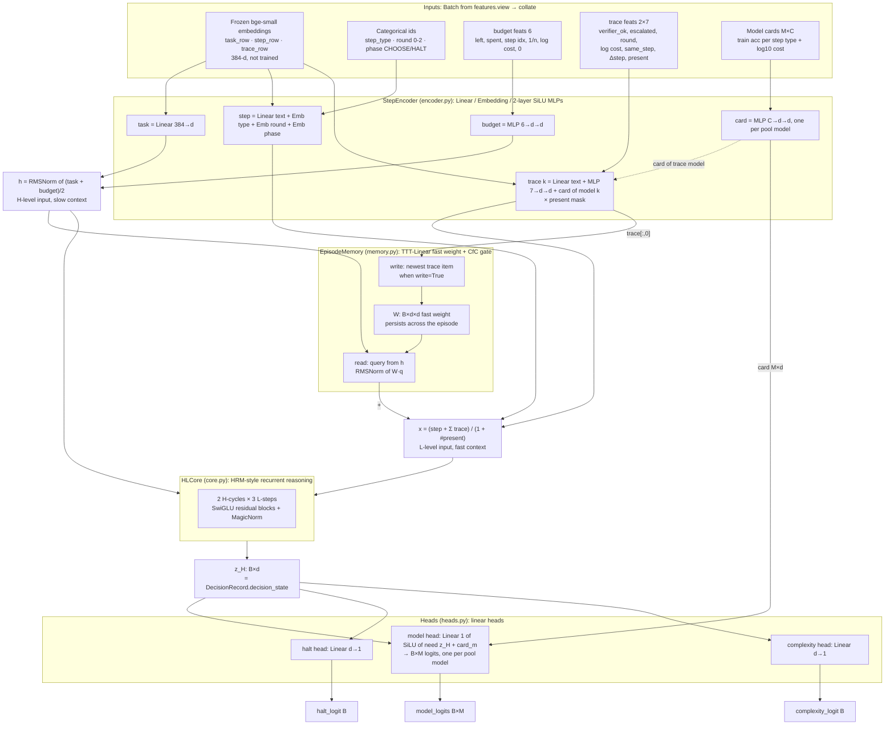
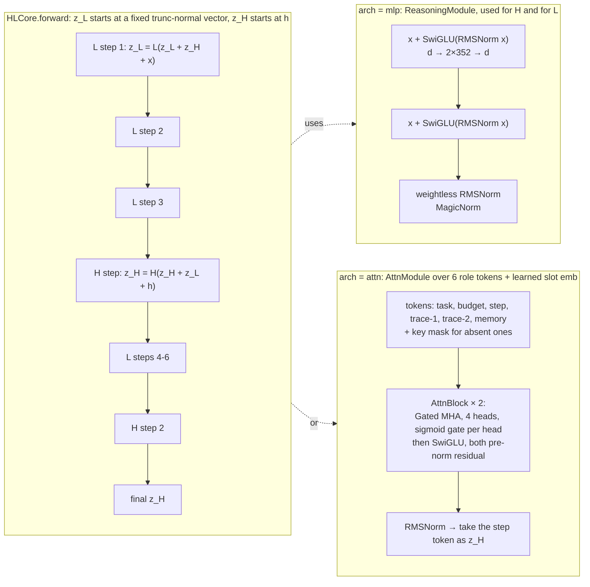
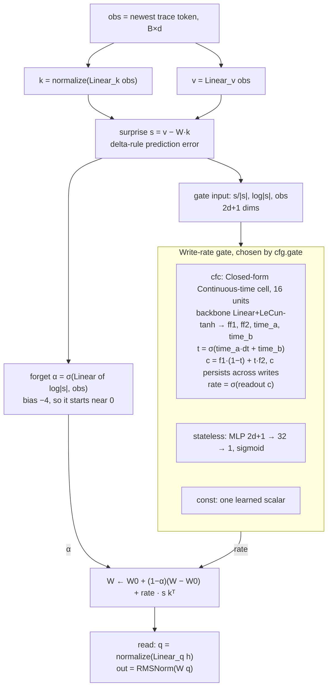
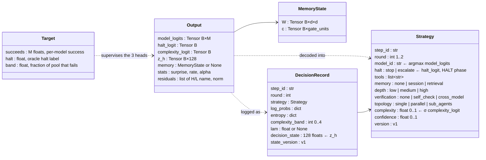

# Controller architecture

Default `full` config: d = 128, `arch="mlp"`, memory on, CfC gate. Variant configs are noted where they differ (see `CONFIGS` in `controller/model.py`).

## 1. End-to-end controller (`full` config)

## 2. H/L reasoning core: the recurrence and the two `arch` options

Training detail: gradients only flow through the last `bp_steps` module calls (a truncated BPTT "staircase"). The horizon widens from 2 to 5 during warmup, as in HRM-Text.

## 3. Episode memory write path (TTT + Titans forgetting + CfC gate)

## 4. Output schema: tensors → contract dataclasses

## Summary of network types

| Component | Network type | Where |
|---|---|---|
| Text features | Frozen **bge-small** sentence embeddings + linear projection | `controller/encoder.py` |
| Categorical features | `nn.Embedding` for step type, round and phase | `controller/encoder.py` |
| Budget, trace and card encoders | 2-layer **MLP** (Linear → SiLU → Linear) | `controller/encoder.py` |
| Reasoning core | **HRM-style hierarchical recurrent** model with an H (slow) and an L (fast) module | `controller/core.py` |
| H/L module (`mlp`) | Pre-norm residual **SwiGLU** blocks + MagicNorm | `controller/core.py` |
| H/L module (`attn`) | **Gated multi-head self-attention** transformer over 6 role tokens | `controller/attention.py` |
| Memory | **Fast-weight associative memory**: TTT-Linear delta rule plus Titans-style forgetting | `controller/memory.py` |
| Write gate | **CfC** (Closed-form Continuous-time liquid neural net) cell | `controller/memory.py` |
| Heads | Linear heads. The model head scores each **model card** against a "need" vector, so the pool size M can change | `controller/heads.py` |

The decoding arrows in diagram 4 (argmax to `model_id`, sigmoid to `complexity`) show what the contracts intend; that decoding isn't in `controller/`. The `tools`, `memory`, `depth`, `verification` and `topology` fields in `Strategy` currently have no head, so they keep their defaults.
